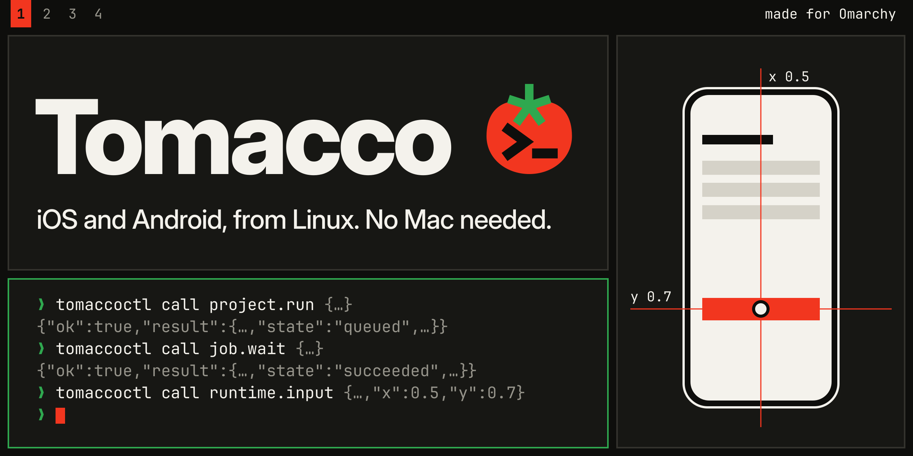
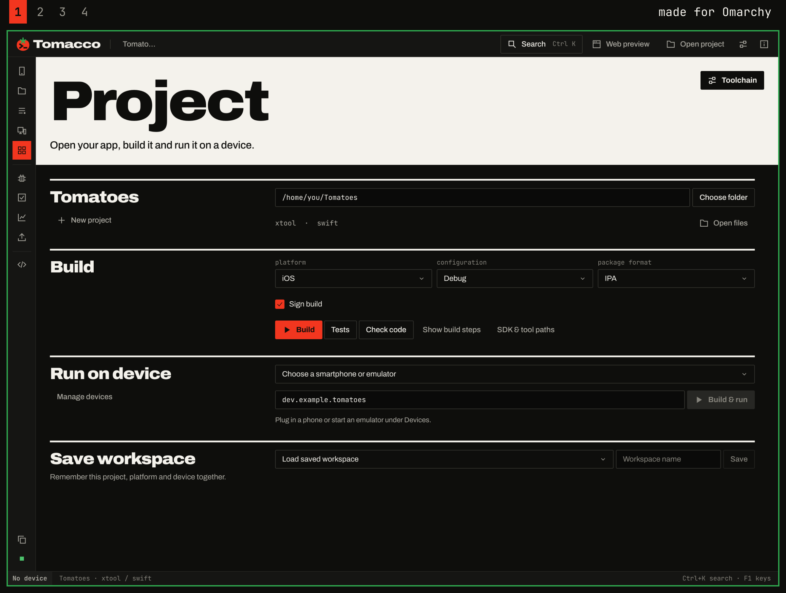
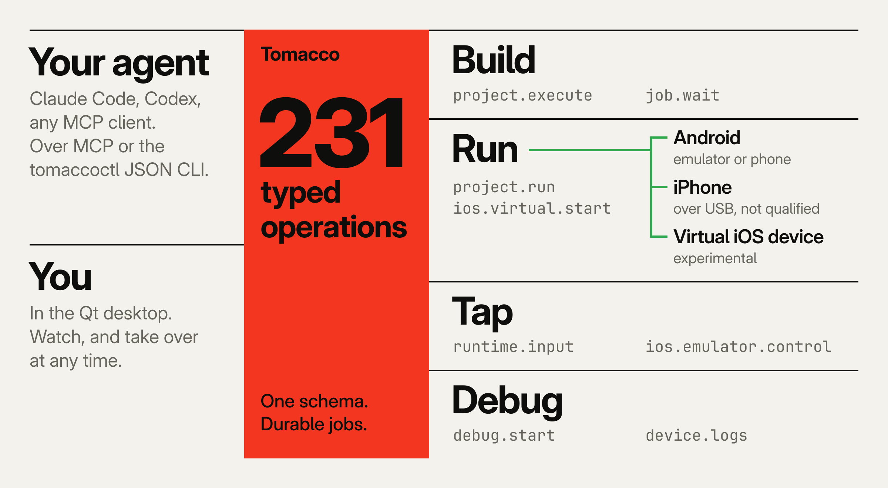
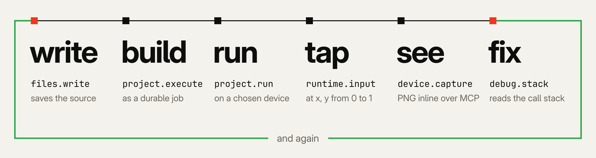

<p align="center">
  
</p>

<p align="center">
  <b>Tomacco: Give your agent a phone.</b><br>
  Build, run and test iOS and Android apps on Linux, with your coding agent or the native desktop.
</p>

<p align="center">
  <a href="LICENSE"></a>
  
  
  
</p>

<p align="center">
  <a href="#quick-start">Quick start</a> ·
  <a href="#for-agents">Connect your agent</a> ·
  <a href="#the-virtual-ios-device">Virtual iOS</a> ·
  <a href="#status-and-limits">Limits</a> ·
  <a href="docs/README.md">Documentation</a> ·
  <a href="CONTRIBUTING.md">Contributing</a>
</p>

## Why Tomacco

Your coding agent can write an app. Tomacco lets it build that app, run it on a
device, tap through the interface, inspect the result and try again.

The agent and the **native Qt desktop** use the same **231 typed operations**
through MCP or the `tomaccoctl` JSON CLI. You can watch the live device, take over
with touch and gestures, and share the same builds, logs and debugging session.
The desktop supports English, German, French, Spanish and Italian.

Tomacco is made for **Omarchy**, with panel and window-manager integration. It
also works on other Linux desktops without those integrations. The virtual iOS
device is experimental and needs a separate setup with your own Apple software;
see [requirements and limits](#the-virtual-ios-device).

## What works today

| Route | What you can do | Start here |
| --- | --- | --- |
| **Android** | Gradle and Flutter builds, emulator and device control, live view, debugging, UI tests and profiling | [Android guide](docs/android.md) |
| **Swift on Android** | Build a Swift core with a native Android UI for ARM64 and x86_64 | [Swift on Android](docs/android.md#swift-on-android) |
| **Virtual iOS device** | Boot iOS 27, run your own arm64 apps and interact with live touch; experimental | [Setup](docs/virtual-ios/setup.md) |
| **iPhone over USB** | Build with xtool, sign, install and view through WebDriverAgent; physical-device execution not qualified | [iPhone guide](docs/iphone.md) |
| **Mac over SSH** | Use Xcode builds, XCTest, the Simulator and App Store validation; not qualified | [Mac route](docs/iphone.md#the-mac-route) |

New in 1.2: UI tests you record by tapping, a watch mode, performance budgets, store screenshots,
SwiftUI apps built, deployed and checked on the virtual iPhone in one call, a virtual iPhone that
starts without a 32 GiB disk copy, an update banner, a Docker image you build yourself, and
`tomaccoctl verify`. Several of these were tested with stand-ins only; the
[release notes](docs/RELEASE_NOTES.md) say which.



<p align="center"><sub>The Project page of the 1.2.1 desktop. A real capture, taken offscreen with no device connected.</sub></p>

## Quick start

**Let your agent do it.** Tell Claude Code, Codex or any coding agent:

> Set up Tomacco for me: https://tomacco.dev/agent

**Or do it yourself:**

```sh
curl -fsSL https://tomacco.dev/install.sh | bash
tomaccoctl setup
```

The first line checks and installs the latest signed release for your user. On Arch and
Omarchy it also offers to install the system packages. The second shows what your computer
can do and offers to install the Android SDK and connect your coding agents.

Arch Linux and Omarchy are the tested platforms. For Debian, Ubuntu and Fedora, a release has a
portable package that bundles Qt and FFmpeg and needs glibc 2.35 or newer; the installer picks it
where the regular package cannot start. See [which package to use](docs/getting-started.md#debian-ubuntu-and-fedora).
To read the script before running it, or to build from source, see
[installation options](docs/getting-started.md#1-install).

Then open a project:

```sh
tomacco --project /path/to/app
```

For a first app, follow [Your first Android app](docs/tutorial-android.md): a Compose starter on
the emulator with a screenshot and a UI test.
For a tour of the interface, see [the desktop guide](docs/desktop.md). For upgrades,
rollback and uninstall, see [installing](docs/building.md#installing).

## For agents

`tomaccoctl setup` connects Claude Code, Codex, Gemini CLI, Cursor, VS Code, Zed and OpenCode, asking
first for each; [connect a client](docs/agents.md#connect-a-client) says which file it changes for each.
The installer also links an [agent skill](docs/agents.md#agent-skill) into `~/.claude/skills`, `~/.codex/skills`
and `~/.agents/skills`, so those agents know when to use Tomacco; `--no-agent-skill` leaves it out.
To connect Claude Code or Codex by hand:

```sh
codex mcp add tomacco -- "$(command -v tomaccoctl)" mcp
claude mcp add --transport stdio --scope user tomacco -- "$(command -v tomaccoctl)" mcp
```

Any stdio MCP client can use the same tools. The server also exposes
`tomacco://catalog` and `tomacco://jobs`. Or use the native `tomaccoctl` executable
directly: every call returns a JSON result, and `schema` lists the operations.

```sh
tomaccoctl schema
tomaccoctl call device.list '{}'
tomaccoctl call project.inspect '{"path":"/absolute/project"}'
```

With the Android tools configured and an emulator running, this is the basic
create → build → run sequence. **Wait for each job to finish before starting
the next step.**

```sh
tomaccoctl call project.create '{"path":"/absolute/NewApp","kind":"android","name":"NewApp","organization":"dev.example"}'
tomaccoctl call project.execute '{"path":"/absolute/NewApp","platform":"android","action":"build","format":"apk"}'
tomaccoctl call project.run '{"path":"/absolute/NewApp","platform":"android","device":"emulator-5554"}'
```

Long operations return a durable job that survives a client disconnect. Keep its
ID and repeat `job.wait` until its state is `succeeded`, `failed`, `cancelled` or
`timed_out`. A queued or running job has not finished.

```sh
tomaccoctl call job.wait '{"job_id":"JOB_ID","seconds":30}'
```

The [agent guide](docs/agents.md) covers the full workflows, argument validation,
device input, debugging and visual checks. [Agent patterns](docs/agent-patterns.md) shows how to
plan with `capabilities`, wait on jobs, act on errors and treat destructive operations, and the
[operation reference](docs/reference/README.md) lists every operation.

<details>
<summary>How the agent, desktop and devices fit together</summary>

<picture>
  <source media="(prefers-color-scheme: dark)" srcset="assets/readme/how-it-works-dark.png">
  
</picture>

<picture>
  <source media="(prefers-color-scheme: dark)" srcset="assets/readme/loop-dark.png">
  
</picture>

</details>

### In a container

For servers, CI and agents that should not install anything on the host, there is a headless
image: `tomaccoctl` from the signed release package, a JDK, Gradle and the Android SDK, and in a
`-emulator` variant the Android Emulator with one system image. It has no desktop and no virtual
iPhone. Building it accepts Google's Android SDK license:

```sh
docker build --build-arg ACCEPT_ANDROID_SDK_LICENSE=1 -t tomacco-container:1.2.1 packaging/container
claude mcp add --transport stdio --scope user tomacco -- docker run -i --rm -v tomacco-data:/data tomacco-container:1.2.1 mcp
```

[Container image](docs/container.md) covers the emulator, KVM, USB phones and what was tested.

## The virtual iOS device

The experimental runtime boots **iOS 27 on an x86_64 Linux PC**: SpringBoard,
Settings, Safari and SwiftUI apps built on Linux, with live touch. A patched QEMU
translates the guest's ARM instructions in software; a Rust renderer draws
Apple's paravirtual GPU through Vulkan.

**This takes additional setup.** It needs your own restore images and a local
Image4 boot manifest, prepared on Linux with the included helper and a public
research template. The [IM4M instructions](docs/virtual-ios/setup.md#how-do-i-get-the-im4m)
give the download and command; no Mac or Apple signing request is needed for that step.
It also needs about 100 GiB of disk,
8 GiB of guest RAM and a Vulkan GPU with about 16 GiB of memory. Initial restore
took about half an hour, followed by about nine minutes from a start to an app.
It is not production-ready.

### Where do I get the Apple images?

The measured setup uses **two exact restore archives**:

| Archive | Version and build | Where we found it |
| --- | --- | --- |
| iPhone 16 (`iPhone17,3`) | iOS **27.0.1 / `24A446`** | The **ipsw.me** firmware catalog |
| PCC virtual device (`vphone600ap`) | cloudOS **26.4 beta / `23E5207q`** | The **`cloud264`** entry in **Lakr233/vphone-cli's** firmware catalog |

Both recorded download URLs point to **Apple's `updates.cdn-apple.com` servers**.
The separate **blacktop/ipsw** command-line tool can look up and download firmware.
The [image preparation guide](docs/virtual-ios/setup.md#obtain-the-apple-images)
gives the exact catalog revision and file, download commands, manifest checks
and disk-image preparation steps. Newer builds are not substitutes.

**Check the applicable Apple terms before downloading or using these images.**
Public availability does not establish permission to decrypt, modify, run or
redistribute them. Apple offers its PCC Virtual Research Environment for research
on Apple silicon Macs and excludes commercial use; those terms do not establish
permission for this Linux runtime or general iOS app development. See
[sources and licensing limits](docs/legal.md#download-sources-and-permission).

### Performance

Measured on one development host: an i9-13900K with a Radeon RX 6000-series GPU.
Every guest processor is emulated, so performance is far below a physical phone.

| Measurement | Result |
| --- | --- |
| App window after launch | about 6.4 to 7.7 s |
| Touch to visible change | about 0.1 s |
| Home-screen swipe | about 7.5-11 changed frames per second |
| Graphics memory over 36 app launches | at most 1.7 GiB |

[Overview and requirements](docs/virtual-ios/README.md) ·
[Setup](docs/virtual-ios/setup.md) · [Usage](docs/virtual-ios/usage.md) ·
[Troubleshooting](docs/virtual-ios/troubleshooting.md)

## Status and limits

Tomacco 1.2.1 was developed and tested on one workstation: x86_64 Arch Linux with Omarchy,
Qt 6.12 and Rust 1.99. The portable package passed its checks in clean Debian 12, Ubuntu 22.04,
Ubuntu 24.04 and Fedora 44 containers but has not been run on a real desktop of those
distributions. Other machines have not been qualified.

**Physical iPhone execution is not qualified.** Build, signing, pairing and runner
paths have contract tests, but execution on a real iPhone has not been verified.
Physical ARM64 Android phones and live Play/App Store submission are also unqualified.

**Linux on Apple Silicon is experimental.** On an M1 MacBook Air, `tomaccoctl`
builds, Rust tests pass and the desktop smoke test passes offscreen. The virtual
iOS device requires an x86_64 host.

| Virtual iOS area | Current state |
| --- | --- |
| App deployment | Supports installing an app on the running phone without a reboot (`ios.virtual.deploy`, about 25 s). SwiftUI apps built with the SDK from your own Xcode download have run; only a few small apps so far. |
| Network | Supports outbound-only NAT networking behind passt, off by default. A guest app saw a working path in a DHCP/DNS test; real traffic through passt remains unproven. |
| Input and storage | Hardware keyboard input and a keychain round-trip have been shown. Persistence is only partly verified. |
| Missing features | Audio, a working debugger, status-bar glyphs and complete graphics support. |
| Widgets | Widget extensions miss chronod's deadline under emulation, so a widget can stay empty. |
| Security | Pointer authentication is bypassed, and other protections are changed. Use your own test apps; keep real accounts and personal data out of the guest. |

The [full runtime limits](docs/virtual-ios/README.md#honest-limits) describe what
was tested and what remains open.

## Documentation

The [documentation index](docs/README.md) lists every guide. Common starting points:

| I want to… | Guide |
| --- | --- |
| Install Tomacco and run a first app | [Getting started](docs/getting-started.md) · [Your first Android app](docs/tutorial-android.md) |
| Connect an agent or automate a workflow | [Agents](docs/agents.md) · [Agent patterns](docs/agent-patterns.md) · [Operation reference](docs/reference/README.md) |
| Run headless in Docker, for agents, servers and CI | [Container image](docs/container.md) |
| Use the workspace and live device view | [Desktop](docs/desktop.md) |
| Develop for Android or an iPhone | [Android](docs/android.md) · [iPhone](docs/iphone.md) |
| Set up the experimental iOS runtime | [Virtual iOS](docs/virtual-ios/README.md) |
| Contribute to the implementation | [Architecture](docs/architecture.md) · [Building and testing](docs/building.md) |
| Check licensing, privacy and release status | [Legal notes](docs/legal.md) · [Privacy](docs/privacy.md) · [Release notes](docs/RELEASE_NOTES.md) |
| Get short answers to common questions | [FAQ](docs/faq.md) |

## Built on the work of others

Tomacco builds on substantial work by the emulator, graphics and mobile-tooling
communities. Thank you to their authors and contributors.

<details>
<summary>Upstream projects and acknowledgements</summary>

**The iOS runtime stands on**
[jprx/qemu-sptm](https://github.com/jprx/qemu-sptm) and [jprx/darwin-vm](https://github.com/jprx/darwin-vm),
[yaelliethy/orchard](https://github.com/yaelliethy/orchard),
[steelbrain/reims-vgpu](https://github.com/steelbrain/reims-vgpu) and [steelbrain/metal2vulkan](https://github.com/steelbrain/metal2vulkan),
[ChefKissInc/Inferno](https://github.com/ChefKissInc/Inferno),
[Lakr233/vphone-cli](https://github.com/Lakr233/vphone-cli),
[linux-apfs/linux-apfs-rw](https://github.com/linux-apfs/linux-apfs-rw),
[rust-vmm/vhost-device](https://github.com/rust-vmm/vhost-device)
and the register definitions of [Asahi Linux's m1n1](https://github.com/AsahiLinux/m1n1).

**Building for iOS on Linux stands on**
[xtool](https://github.com/xtool-org/xtool),
[go-ios](https://github.com/danielpaulus/go-ios),
[Appium WebDriverAgent](https://github.com/appium/WebDriverAgent),
[cctools-port](https://github.com/tpoechtrager/cctools-port) and [apple-libtapi](https://github.com/tpoechtrager/apple-libtapi),
[ldid](https://github.com/ProcursusTeam/ldid) and [ipsw](https://github.com/blacktop/ipsw).
Android's device view uses [scrcpy](https://github.com/Genymobile/scrcpy).

**Related projects worth knowing.**
[joshuaswarren/omarchy-apple-dev](https://github.com/joshuaswarren/omarchy-apple-dev) builds and deploys SwiftUI and Flutter apps from Omarchy to a real iPhone, and pointed us to a toolchain bug of our own.
[JonathanInTheClouds/omarchy-ios-kit](https://github.com/JonathanInTheClouds/omarchy-ios-kit) adds hot reload and VS Code debugging on top of it.
Tomacco ships no code from either. On request, `ios.toolkit_install` fetches a pinned commit of omarchy-apple-dev into Tomacco's data directory, and Tomacco's operations for Flutter on iOS, Xcode project import, crash reports and App Store builds call its scripts ([what ran and what did not](docs/iphone.md#flutter-xcode-projects-crash-reports-and-the-app-store)). Tomacco uses nothing from omarchy-ios-kit. Thanks to Joshua Warren and, for the Flutter pipeline, dl-alexandre.

Licenses and required notices: [THIRD_PARTY_NOTICES.md](THIRD_PARTY_NOTICES.md).

</details>

## Contributing

See [CONTRIBUTING.md](CONTRIBUTING.md) for the workflow and
[SECURITY.md](SECURITY.md) for private vulnerability reports. Most development
and unit tests need no iOS image.

## Support the project

If Tomacco saves you time, you can support development through
[GitHub Sponsors](https://github.com/sponsors/marselnenaj).

## Legal notice

Tomacco is an independent project. Its documentation describes technical
behavior and source provenance; it does not provide legal clearance or grant
rights to Apple software.

- **Apple materials.** No Apple firmware, iOS image or Apple binary is part of this repository or its packages. You supply your own images and SDK, and prepare the research boot manifest locally.
- **Protection changes.** The research runtime changes or bypasses some Apple protections on local copies. [The legal notes](docs/legal.md#parts-that-change-apples-protections) describe those changes. Keeping copies private or describing a use as research does not by itself establish permission.
- **Applicable terms.** Review the agreements for your software and the law relevant to your use. This README is not legal advice or a guarantee that a particular use is lawful.
- **No warranty.** Tomacco is supplied without warranty under the GPL.

Tomacco is not affiliated with, endorsed by or sponsored by Apple, Google or
Samsung, and is independent of Omarchy. Names identify compatible platforms;
see the [trademark notice](docs/legal.md#trademarks).
Tomacco sends no telemetry; [privacy.md](docs/privacy.md) explains its network use.

## License

Copyright (C) 2026 Marsel Nenaj and Tomacco contributors.

Tomacco's source is licensed under **GPL-2.0-or-later**; see [LICENSE](LICENSE)
and [COPYRIGHT](COPYRIGHT). Distributed binaries are conveyed under **GPL version 3**
because of their dependencies. The emulator patches keep their upstream licenses.

<details>
<summary>Binary distribution terms and required notices</summary>

- **Binaries.** `tomaccoctl` links Apache-2.0 crates (`prost`, `sync_wrapper`),
  and the desktop links Qt 6 (LGPL-3.0) and, on Arch, a GPL-3.0 build of
  FFmpeg. The portable package bundles Qt and an LGPL-only FFmpeg build. Distributed binaries are therefore conveyed under GPL version 3, as
  the "or later" option allows. Packages install its text as
  `COPYING.GPL-3.0`, and [SOURCE.md](docs/SOURCE.md.in) names the version
  and commit they were built from and where the corresponding source is
  offered.
- **Patches.** The patch series in `integrations/ios-emulator/` keep the
  license of the project each one changes.

Every component, with its license and required notices, is listed in
[THIRD_PARTY_NOTICES.md](THIRD_PARTY_NOTICES.md). The protocol definitions are
also listed in [native/protocol/THIRD_PARTY.md](native/protocol/THIRD_PARTY.md).

</details>
