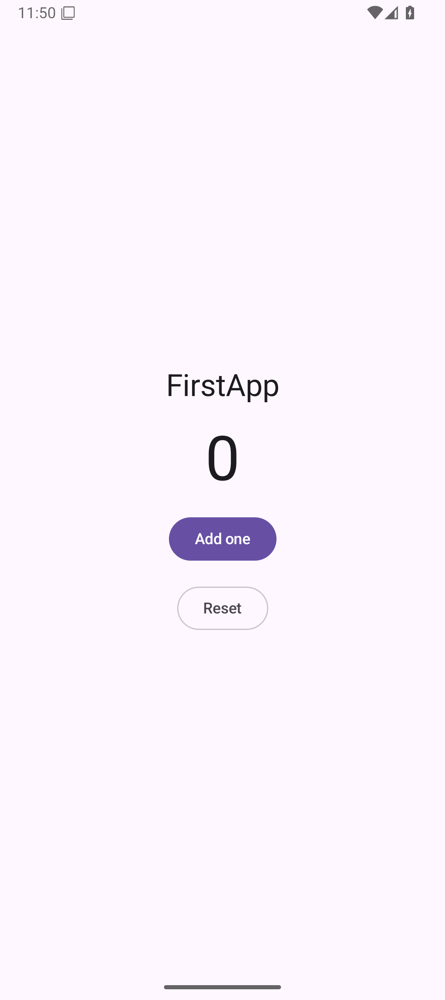

# Your first Android app

From an installed Tomacco to a Jetpack Compose app running on the Android Emulator, with a
screenshot, a tap checked from outside the app and a passing UI test. Every step is one
`tomaccoctl` call; an agent makes the same calls over MCP.

**How long it takes.** On the development host, with the Android SDK, the system image, a JDK
and Gradle's dependency cache already present, steps 2 to 8 below took 103 seconds, from
configuring the tools to a passing UI test. A first run downloads more: about 5 GB for the SDK
and emulator image in `tomaccoctl setup`, and Gradle's Compose dependencies at the first build.
Those downloads were not timed.

## 1. Install and set up

```sh
curl -fsSL https://tomacco.dev/install.sh | bash
tomaccoctl setup
```

Say yes to Android in `tomaccoctl setup`: it installs the SDK and an emulator called `Tomacco`.
[Getting started](getting-started.md#1-install) has the other ways to install, and
[route C](getting-started.md#route-c-a-new-android-app) the manual Android setup.

The timed run used its own state directory, `TOMACCO_HOME=/absolute/tutorial-home`, so it left the
regular emulators and settings alone. You can do the same; leave it out to use your normal setup.

## 2. Check what this computer can do

```sh
tomaccoctl call capabilities '{}'
```

Under `android`, `build`, `emulator` and `devices` should each say `"ready": true`. `emulator`
also lists the emulators you have under `avds`. If something is not ready, its `missing` names
what, and `tomaccoctl doctor` says how to fix it.

If you already pointed Tomacco at an SDK, JDK and Gradle elsewhere, `settings.configure` does it
in one call:

```sh
tomaccoctl call settings.configure '{"android_sdk":"/absolute/Android/Sdk","java_home":"/usr/lib/jvm/default","executables":{"gradle":"/usr/bin/gradle"}}'
```

## 3. Start an emulator

`tomaccoctl setup` made one called `Tomacco`. To make another, name an installed system image and
a phone profile from `tomaccoctl call catalog.list`:

```sh
tomaccoctl call android.avd_create '{"name":"FirstRun","system_image":"system-images;android-36;google_apis;x86_64","profile_id":"pixel-11"}' --wait
tomaccoctl call android.avd_start '{"name":"FirstRun","headless":true}'
```

`--wait` follows a job until it ends and prints the final job. `android.avd_start` returns at
once: the emulator runs as a job for as long as it is up, so do not wait for that job. Instead
repeat `device.list` until the emulator is listed with `"state":"device"`; it is usually
`emulator-5554`. In the timed run that took about 20 seconds. Leave out `headless` to see the
emulator's window.

```sh
tomaccoctl call device.list '{"platform":"android"}'
```

## 4. Create the app

```sh
tomaccoctl call project.create '{"path":"/absolute/FirstApp","kind":"compose","name":"FirstApp","organization":"dev.example"}'
```

This writes a Kotlin and Jetpack Compose app with a versions catalog: a counter with **Add one**
and **Reset**, and one Compose UI test in `app/src/androidTest`. The result names its
application ID, `dev.example.firstapp`.

## 5. Build and run it

```sh
tomaccoctl call project.run '{"path":"/absolute/FirstApp","platform":"android","device":"emulator-5554"}' --wait
```

The job runs Gradle's `installDebug` and then launches the app. Its log goes to standard error
while it runs; standard output gets the finished job, `"state":"succeeded"`. Without `--wait`, as
an agent over MCP would, keep `result.id` and repeat `job.wait` until the state is `succeeded`,
`failed`, `cancelled` or `timed_out`:

```sh
tomaccoctl call job.wait '{"job_id":"JOB_ID","seconds":60}'
```

## 6. Take a screenshot

```sh
tomaccoctl call device.capture '{"platform":"android","device":"emulator-5554","path":"/absolute/first.png"}'
```

The result has the file's path, size and SHA-256. This is the screenshot from the timed run:



## 7. Tap it and check the result

Find controls by their text instead of coordinates:

```sh
tomaccoctl call testing.action '{"device":"emulator-5554","selector":{"text":"Add one"},"action":"click"}'
tomaccoctl call testing.find '{"device":"emulator-5554","selector":{"text":"1"},"timeout":5}'
```

`testing.find` answers the matching elements under `matches`, with their bounds; an empty list
after the timeout means the counter did not change.

## 8. Run the UI test

```sh
tomaccoctl call project.execute '{"path":"/absolute/FirstApp","platform":"android","action":"instrumented-test"}' --wait
```

Gradle builds the test APK and runs `CounterTest` on the emulator. Then read the results as one
summary, passing the test job's id so that results of an earlier run are not counted:

```sh
tomaccoctl call testing.results '{"path":"/absolute/FirstApp","job_id":"JOB_ID"}'
```

In the timed run it answered `"passed":true` with `"tests":1,"passed":1,"failed":0`. A failure
lists the test, its message and its stack under `failures`.

## 9. Clean up

Stop the emulator:

```sh
tomaccoctl call android.emulator '{"device":"emulator-5554","action":"stop"}'
```

With a separate `TOMACCO_HOME`, deleting that directory removes the emulator made in step 3 and
the job records. The project is an ordinary Gradle project; open it with
`tomacco --project /absolute/FirstApp` or in Android Studio.

## Where next

- [Recipes](recipes.md): short sequences for the next things to try.
- [Agent patterns](agent-patterns.md): how an agent plans, waits and recovers with the same calls.
- [Android](android.md): the live view, debugging, settings for tests and profiling.
- [Troubleshooting](troubleshooting.md) when a step fails: read the error's `message` and `remedy` first.
